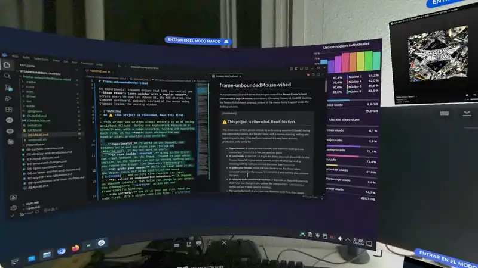

# frame-unboundedMouse-vibed

An experimental SteamVR driver that lets you control the **Steam Frame's laser pointer with a regular mouse**, across every VR overlay (Steam UI, the KDE desktop, the SteamVR dashboard, popups), instead of the mouse being trapped inside the desktop window.

<p align="center">
  
</p>

> [!WARNING]
> ## ⚠️ This project is vibecoded. Read this first.
>
> This driver was written almost entirely by an AI coding assistant (Claude) over several sessions on a Steam Frame, with a human steering, testing and approving each step. It has **not** been reviewed the way hand-written, production code would be.
>
> - **Experimental.** It works on one headset, one SteamOS build and one mouse (see [Tested on](#tested-on)). It may not work on yours.
> - **It runs inside `vrserver`.** A bug in the driver can crash SteamVR. On the Frame, SteamVR is your whole session, so the headset can end up showing nothing until you remove the driver (see [Recovery](#recovery)).
> - **It grabs your mouse.** While the laser mode is on, the driver takes exclusive control of the mouse (`EVIOCGRAB`), and nothing else receives its input.
> - **It relies on undocumented behaviour.** It depends on SteamVR internals that Valve can change in any update: the compositor's `lasermouse` action set and Frame-specific bindings.
> - **No warranty.** Use it at your own risk. Read the code first. It's two files: [`src/core.h`](src/core.h) (the logic) and [`src/driver.cpp`](src/driver.cpp) (SteamVR and mouse I/O).

### How it's built
An engineer is behind the wheel. The code is AI-written, but not because the problem was thrown at an LLM until something stuck. The AI is quick at the typing; the parts that matter stay human. Every claim is checked against Valve's own files or the logs, every change is tested on the headset, and the [development log](docs/development-log.md) records what worked, what didn't, and what we got wrong.

## What it does

The Frame's laser pointer is drawn by SteamVR's compositor. The compositor aims it with whatever tracked device supplies a *pose*, normally a controller. A physical mouse never reaches that system: gamescope consumes it and clamps it to whichever window has focus.

This driver adds a **virtual controller** to SteamVR:
- **Position:** follows your head.
- **Direction:** aimed by mouse movement.
- **Buttons:** your mouse buttons.

The compositor then treats it like any other laser-pointing controller.

| Mouse | Laser mode OFF (default) | Laser mode ON |
|---|---|---|
| Forward side button (BTN_EXTRA) | **Turns laser mode on** | **Turns laser mode off** |
| Movement | Normal desktop cursor | Aims the laser (world-locked: turning your head doesn't move it) |
| Left / right / middle button | Normal | Laser click / right click / middle click |
| Back side button (BTN_SIDE) | Normal | SteamVR's laser **Back**, the same action as the right Frame controller's B button. Works in Steam UI menus; it does not reach the KDE desktop (see Known limitations). |
| Wheel (and tilt wheel) | Normal | Acts like the controller **thumbstick**. One notch moves one item in Steam UI lists, and spinning the wheel scrolls continuously. It also scrolls the overlay under the laser. |

When laser mode turns on, the ray starts where you're looking. When it's off, the virtual device stays connected but parks its ray pointing at the sky with every button released, so your real controllers keep the laser.

Since 0.5.1 the virtual device is a **stylus** (`/user/stylus`) while laser mode is off, so it doesn't take your real controllers' slots (while off, the stylus also reports itself disconnected). While laser mode is on it switches to the **left hand** (`activeRole`), because SteamVR only lets hands drag overlays. The owner tested this switch with 0.5.1 and reports it works (see the development log).

## Requirements
- A Steam Frame (aarch64, SteamOS VR variant) with SteamVR at `/opt/steamvr`.
- A USB or Bluetooth mouse. Your user must be able to read `/dev/input/event*`; the default `steamos` user is in the `input` group.
- `gcc` or `clang`, `cmake` and `ninja`. They are not guaranteed to be on a stock image; installing them may require disabling SteamOS read-only mode.
- The OpenVR driver header is **not vendored**. The build uses the copy SteamVR ships at `/opt/steamvr/tools/hellovr_vulkan_linux/src/openvr/headers`. Override it with `-DOPENVR_HEADERS=<dir>`.

## Quick install
One line, the way everybody does it these days:
```sh
curl -fsSL https://raw.githubusercontent.com/Andalu30/frame-unboundedMouse-vibed/main/quick-install.sh | bash
```

<details>
<summary>Should I run that?</summary>

**¯\\_(ツ)_/¯** Who knows? Everybody does that right? It's just totally gonna install this driver... and nothing else...
</details>

## Build and install
```sh
cmake -S . -B build -G Ninja && cmake --build build
./install.sh      # registers driver/mouselaser with vrpathreg (backs up openvrpaths.vrpath first)
# then REBOOT the headset
```

`install.sh` refuses to run if another driver named `mouselaser` is already registered from a different folder.

KDE may pop up "could not read file `vrmonitor://driverinstalled`". That's harmless. After registering a driver, `vrpathreg` runs `xdg-open vrmonitor://driverinstalled` to notify SteamVR's desktop status window, and nothing on the Frame handles that link. The registration has already been saved by then.

Check that it loaded:
```sh
grep -a 'mouselaser:' ~/.local/share/Steam/logs/vrserver.txt | tail
# expect: "version 0.7.0-experimental", "settings: ...", "activated as device N, role 5", "using /dev/input/eventX (<your mouse>)"
```
Or run `tools/check-log.sh` for a summary (read-only).

## Uninstall
```sh
./uninstall.sh    # then reboot
```

## Settings
The common ones are in SteamVR's settings, in a **Mouse Laser** section: sensitivity, invert vertical aim, wheel mode, the laser mode and Back buttons, and the laser hand. The switch-on delay is there too, among the advanced settings. All of them, including the rest, can also be set in `~/.config/openvr/config/steamvr.vrsettings` under a `"driver_mouselaser"` section.

The driver notices a change within a second and applies it right away. These need a SteamVR restart instead: `toggleButton`, `backButton`, `role`, `activeRole`, `deviceNameFilter`, `reconnectGraceS` and `enable`. On the Frame, restarting SteamVR also closes the desktop and everything in it, so you may prefer to reboot.

A value out of its range is corrected and logged as `setting ...`. The log shows the values in use on a `settings: ...` line, and `settings changed ...` when they change.

| key | default | meaning |
|---|---|---|
| `enable` | `true` | `false` loads the driver but adds no device. This is the kill switch. |
| `sensitivity` | `0.05` | Degrees of ray rotation per mouse count. |
| `toggleButton` | `276` | evdev key code of the toggle: 276 = BTN_EXTRA (forward), 275 = BTN_SIDE (back). |
| `backButton` | `275` | evdev key code that sends the laser Back action while laser mode is on (275 = BTN_SIDE). `-1` disables it. |
| `role` | `5` | Role while laser mode is off. 5 = stylus (its own `/user/stylus` path, doesn't collide with real controllers, reports itself disconnected while off). 1 = left hand, 2 = right hand: these share the slot with that real controller and stay connected while off, so that controller loses its laser all the time. |
| `activeRole` | `1` | Role while laser mode is on. 1 = left hand, 2 = right hand: needed to drag overlays (a stylus drag follows your head). `0` keeps `role`. While on, the real controller of that hand loses its laser. |
| `deviceNameFilter` | `""` | Substring of the evdev mouse name. Empty means any device with REL_X/REL_Y and BTN_LEFT that isn't a Valve/Steam device, preferring one that has the toggle button. |
| `claimDelayMs` | `50` | Wait after switching on before pulsing the grip, so SteamVR has picked up the role change. Raise it if the laser sometimes doesn't appear. |
| `pulseMs` | `60` | Length of the grip and bumper pulses. |
| `reconnectGraceS` | `60` | If the mouse disappears (e.g. a Bluetooth mouse napping) while laser mode is on, keep laser mode this long and continue when it returns. |
| `originOffsetY` | `-0.08` | Ray origin height relative to the HMD, in metres. |
| `invertY` | `false` | Invert vertical aim. |
| `wheelMode` | `"smooth"` | `"smooth"`: each notch bumps the virtual stick, which then eases back, and spinning holds it. `"step"`: each notch is one fixed flick (the 0.2.0 behaviour). |
| `wheelDeflection` | `1.0` | Maximum stick deflection (0–1), in both modes. |
| `wheelSmoothMin` | `0.7` | *smooth:* deflection after a single notch. Keep it above the UI's step threshold (about 0.5). |
| `wheelSmoothImpulse` | `0.3` | *smooth:* extra deflection added by each further notch, so faster spinning pushes harder. |
| `wheelSmoothHoldMs` | `80` | *smooth:* how long after a notch the stick holds before easing back. |
| `wheelSmoothDecayMs` | `150` | *smooth:* how fast it eases back (exponential time constant). Lower is snappier, higher glides longer. |
| `wheelPressMs` | `90` | *step:* how long each notch holds the stick pushed. |
| `wheelReleaseMs` | `60` | *step:* gap at centre between queued notches. |
| `wheelMaxQueued` | `10` | *step:* maximum notches buffered. |

**Tuning the wheel:**
- One notch skips two list items: lower `wheelSmoothHoldMs`.
- Scrolling stops abruptly: raise `wheelSmoothDecayMs`.
- Fast spins aren't fast enough: raise `wheelSmoothImpulse`.

## Recovery
If SteamVR won't come up properly after installing, there are four options:
0. In VR, open **Manage Add-ons**, switch *mouselaser* off, then reboot.
1. **SSH or RDP in** (`xrdp` runs on the Frame), run `./uninstall.sh` or `vrpathreg removedriver <path>/driver/mouselaser`, and reboot.
2. Set `"driver_mouselaser": { "enable": false }` in `steamvr.vrsettings`, then reboot.
3. Restore the backup: `cp ~/.config/openvr/openvrpaths.vrpath.bak-mouselaser ~/.config/openvr/openvrpaths.vrpath`.

## Tested on
| | |
|---|---|
| Device | Steam Frame (Snapdragon SM8650) |
| SteamOS | `VERSION_ID=0.4.2`, `VARIANT_ID=vr`, build `20260928.6175029` |
| Kernel | `6.18.0-gfbdbca41fd45` |
| SteamVR | the version bundled with that SteamOS build, at `/opt/steamvr` |
| Mouse | MCHOSE G3 A (2.4 GHz, has BTN_SIDE/BTN_EXTRA) |
| Result | Loads, toggles, aims and clicks across overlays. Reconnects after the mouse sleeps or replugs. The wheel scrolls Steam UI lists like the thumbstick: 0.2.0 worked but felt a bit choppy. 0.3.0's smooth mode was confirmed working by the owner. 0.5.1 (stylus while off, left hand while on) reported working by the owner, including quick off/on toggles. |
| **0.6.1 retest** | SteamOS `0.5.9` (build `20261113.6134720`), kernel `7.2.0`, same mouse over Bluetooth. Every activation showed the laser, about 100 ms after the button is released (development log, 0.6.1). |
| **0.7.0 retest** | SteamOS `0.5.10` (build `20261118.6185655`), kernel `7.2.0`, SteamVR 2.19.4, same mouse. 0.6.2, 0.6.3 and 0.7.0 tested in turn: toggling, aim and click, drag, wheel, Back, real controllers, unplug/replug, and the settings page with live changes (development log). |

## Known limitations
- **Fixed in 0.6.1: in 0.5.1, about every other activation needed three presses.** On the Frame the grip button *toggles* between Laser Mouse and Gamepad mode, and 0.5.1 pressed it on every activation without ever pressing it back. 0.6.1 presses it once on and once more on exit. Details in the [development log](docs/development-log.md), 0.6.0 and 0.6.1.
- If something else switches the laser to Gamepad mode while laser mode is on (for example a real controller's grip), the next activation may need one extra off/on. The driver can't see the laser's mode.
- Since 0.6.0 the toggle fires when you *release* the button, and the app in focus sees that one click (some apps treat it as "forward").
- While laser mode is off, the virtual stylus reports itself **disconnected**, so SteamVR logs it being deactivated and activated again (`event 101`/`100`) on every switch. This is the tested behaviour and causes no visible problem.
- The ray starts just below your head (`originOffsetY`) and points where you aim, so you see the beam almost end-on. Expect to rely mostly on the cursor dot on overlays.
- While laser mode is on, the **real controller of the `activeRole` hand loses its laser** (the left one by default; confirmed by the owner). It gets it back when laser mode is switched off. Set `activeRole: 2` to borrow the right hand instead. With `role` 1 or 2 it happens all the time, because a hand role stays connected while off.
- With a stylus role active (`activeRole: 0`), the mouse laser can aim and click but **can't drag overlays**: they follow your head. SteamVR's compositor only drags with hands or the head.
- **Wheel feel is approximate.** A wheel isn't a stick: it only sends notches. Smooth mode only *simulates* a held stick, so it still won't feel exactly like a real thumbstick. Tune it with the `wheel*` settings.
- Some settings only take effect after a SteamVR restart (see [Settings](#settings)).
- **Back doesn't reach the KDE desktop.** SteamVR's laser Back goes to SteamVR overlays. Steam's UI handles it, but gamescope doesn't pass it on to the windows it hosts (a real controller's B behaves the same). With laser mode off, the side buttons don't work in KDE either, because the nested KWin's X11 backend drops X buttons 8 and up. See [docs/steam-frame-background.md](docs/steam-frame-background.md).
- Two harmless log lines:
  - `steam.client (mouselaser) has no configured binding`: only the compositor bindings are provided, and Steam's own binding for the Frame controllers is haptics-only anyway.
  - `Driver mouselaser has no suitable devices`: logged at load time, presumably because the driver provides no HMD. The device is added right after.

## Docs
- [docs/steamvr-primer.md](docs/steamvr-primer.md): **start here if SteamVR is new to you.** SteamVR internals (drivers, devices, roles, input bindings, the compositor's laser) and the Steam Frame specifics this project touches.
- [docs/how-it-works.md](docs/how-it-works.md): the driver internals, the pose math and the bindings.
- [docs/steam-frame-background.md](docs/steam-frame-background.md): what we learned about the Frame's display and input stack that led here.
- [docs/testing.md](docs/testing.md): the automated tests and the checks to run on the headset.
- [docs/development-log.md](docs/development-log.md): one short entry per version: what changed and whether it was tested.
- [CLAUDE.md](CLAUDE.md): context and ground rules for AI coding sessions on this repo.


## License
[MIT](LICENSE) © 2026 Andalu30 and contributors.

Third-party notes:
- **OpenVR SDK header** (`openvr_driver.h`, © Valve Corporation, BSD-3-Clause in the public [OpenVR SDK](https://github.com/ValveSoftware/openvr)). It is **not included** in this repo. The build uses the copy SteamVR ships on the headset.
- **SteamVR** is proprietary Valve software. This project doesn't contain or redistribute any of it. The input profile and bindings files follow SteamVR's documented JSON formats so the driver can interoperate.
- Not affiliated with or endorsed by Valve. "Steam", "SteamVR" and "Steam Frame" are trademarks of Valve Corporation.
